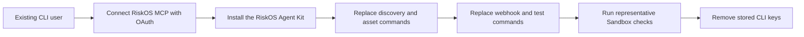

# Move from RiskOS CLI to RiskOS MCP

RiskOS CLI stays available during the migration period. Do not use it for new
integrations.

The replacement has two parts:

- RiskOS MCP provides OAuth-authenticated RiskOS tools, prompts, and resources.
- The RiskOS Agent Kit distributed by Socure teaches supported agents how to
  use those tools and includes narrow local smoke scripts.

Request the Agent Kit package from your Socure representative or support
contact. It is not downloaded from a public repository.

## Authentication

| Existing CLI | Replacement |
| --- | --- |
| `RISKOS_API_KEY` or keychain MCP key | Accounts v2 OAuth connection to RiskOS MCP |
| `RISKOS_EVAL_KEY` | OAuth Sandbox evaluation tool for agent-driven tests |
| Direct Evaluation API key for local credential checks | Agent Kit `evaluation_smoke.py` |

Human users connect through OAuth Authorization Code with PKCE. Automated
clients use an Accounts v2 service principal with explicit account, role, and
use-case assignments.

The hosted MCP server never receives a customer's direct Evaluation API key.

## Command replacements

| CLI command | RiskOS MCP or Agent Kit replacement |
| --- | --- |
| `riskos auth login` | Connect the RiskOS MCP server through the agent host's OAuth flow |
| `riskos auth status` | Ask the agent to show the current RiskOS actor, account, use cases, and permissions |
| `riskos usecase list` | `riskos_get_context` |
| `riskos workflow list <usecase>` | `riskos_list_workflows` |
| `riskos asset guide <usecase>` | `riskos_get_integration_checklist` and `riskos_search_documentation` |
| `riskos asset openapi` | Read `riskos://openapi/evaluation/v1` |
| `riskos asset webhook-spec` | Read `riskos://openapi/webhooks/v1` |
| `riskos asset testcases <usecase>` | `riskos_manage_test_cases` with the list action |
| `riskos webhook events` | `riskos_manage_webhooks` with the events action |
| `riskos webhook list` | `riskos_manage_webhooks` with the list action |
| `riskos webhook create` | `riskos_manage_webhooks` with preview, confirmation, and idempotency |
| `riskos webhook update` | `riskos_manage_webhooks` with preview, confirmation, and idempotency |
| `riskos webhook simulate --dry-run` | Agent Kit `webhook_smoke.py --dry-run` |
| `riskos webhook simulate --target http://localhost...` | Agent Kit `webhook_receiver.py` and `webhook_smoke.py` |
| `riskos webhook simulate --target https://remote...` | Use the confirmed webhook test action through `riskos_manage_webhooks`, or test the customer endpoint with their own approved HTTP client |
| `riskos testcase list` | `riskos_manage_test_cases` with the list action |
| `riskos testcase describe` | `riskos_manage_test_cases` with the get action |
| `riskos testcase run` | `riskos_submit_sandbox_evaluation` |

## Local smoke tests

Use the Agent Kit scripts when the test must run on the customer's machine:

- `webhook_receiver.py` starts a loopback-only receiver.
- `webhook_smoke.py` sends synthetic OpenAPI-derived webhook events to a
  loopback receiver.
- `evaluation_smoke.py` validates a customer-entered Sandbox Evaluation API
  credential without sending it to RiskOS MCP.

## Migration flow

Keep the CLI installed until the same integration checks pass through MCP and
the Agent Kit. Then run `riskos auth logout` and remove any CLI-only environment
variables from local and CI configuration.
